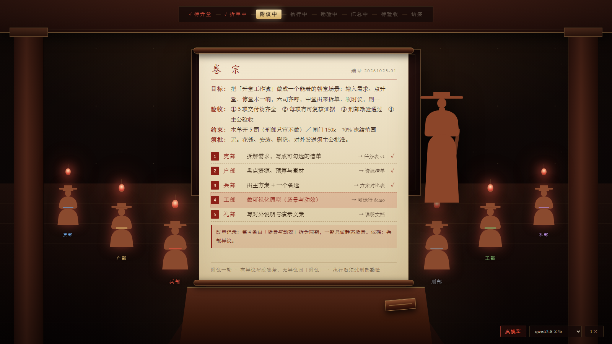

# 升堂 · 把多智能体协作做成一场朝堂议事

> 输入需求 → 点「升堂」→ 惊堂木一响、中堂喊「肃静」→ 六司齐呼 → 中堂拆单 → 附议 → **主公过目** → 执行 → **刑部勘验** → 汇总 → 主公裁决

一套**看得见的多 Agent 协作协议**。不是又一个把日志打在终端里的编排框架——它把「谁在干什么、卡在哪一步、谁说了算」变成画面。



---

## 为什么做这个

多 Agent 系统真正的问题，不是模型不够聪明，是**过程不可见**：

- 用户不知道跑到第几步，只能干等
- 出了错，不知道是哪一环、该找谁
- 执行者自己汇报「已完成」，没人核
- 多个 Agent 各说各话，没有统一报文，汇总时全是噪音

这套协议的解法和大流相反：**不追求让 Agent 更自由，而是给它们定死一套朝堂礼仪**——固定的角色、固定的状态、固定的报文、固定的裁决方式。

礼仪不是为了好看。**礼仪是为了让过程可审计。**

---

## 架构

```
┌──────────────────────────────────────────────┐
│  stage/      朝堂演出层（HTML）               │
│  惊堂木 · 六司齐呼 · 卷轴 · 勘验              │
└────────────────▲─────────────────────────────┘
                 │ SSE 事件流
┌────────────────┴─────────────────────────────┐
│  orchestrator/  升堂编排器（Python）          │
│  八态状态机 · 报文校验 · 四层兜底 · 闸门       │
└────────────────▲─────────────────────────────┘
                 │ 快路：裸调 /chat/completions
                 │ 慢路：DSH SDK（带工具与会话）
┌────────────────┴─────────────────────────────┐
│  任意 OpenAI 兼容端点                         │
│  本地 llama.cpp / LM Studio / Ollama / 云端   │
└──────────────────────────────────────────────┘
```

**两条路，按任务性质选**：

| | `quick()` 快路 | `chat()` 慢路 |
| --- | --- | --- |
| 用途 | **五个环节全走这条**：拆单、附议、执行、勘验、汇总 | 只在快路不可用时兜底 |
| 起 runtime | 不起，零子进程 | 起 |
| 带工具 | 不带 | 带全套 |
| 实测耗时 | 拆单约 4 秒；整场 45–90 秒 | 数分钟 |

原本设想「执行、勘验要动手，得走带工具的慢路」。实测发现这两件事本质都是「读一段、写一段」，用快路快一个数量级，也不需要工具——执行是模型写正文、程序落盘，勘验是程序查事实、模型判内容。

慢路留着，是为了在裸调端点不可用时还能跑通。

---

## 六部制

| 位置 | 名号 | 职掌 |
| --- | --- | --- |
| 出题与裁决 | **主公** | 提需求、拍板、验收 |
| 总控 | **中堂** | 拆单、派司、收附议、汇总 |
| 一司 | **吏部** | 拆解需求、定人定责 |
| 二司 | **户部** | 资源、预算、素材、数据 |
| 三司 | **礼部** | 文案、呈现、对外表达 |
| 四司 | **兵部** | 攻坚、技术实现 |
| 五司 | **刑部** | **只审不做**：核证据、驳不合格 |
| 六司 | **工部** | 组装、打包、交付 |

选六部不是为了复古，是因为**名字自带职责**。说「这活归兵部」，不用再解释兵部干什么。

---

## 八态状态机

```
待升堂 → 拆单中 → 附议中 → 执行中 → 勘验中 → 汇总中 → 待验收 → 结案
                    ↑                                      │
                    └──── 退回（改一句需求重下一单）────────┘
```

每一态在界面上只有一种合法画面，跳步就是错。

---

## 四个关键设计

### 1. 附议轮必须能被打断

绝大多数多 Agent 流程是「派活 → 干活 → 汇总」，中间没有共识环节，错了只能返工。

这里加了**附议轮**：拆单后所有司必须表态，`附议` 或 `异议（写明改哪条、为什么）`。异议最多两轮，仍谈不拢就列分歧上抛主公——**有兜底，不会死循环**。

关键不在「调模型表态」，在**给每个司不同的视角**：

| 司 | 它盯什么 |
| --- | --- |
| 吏部 | 活派得清不清——有没有两条在说同一件事 |
| 户部 | 资源够不够——素材、数据、时间撑不撑得住 |
| 礼部 | 对外能不能说——措辞有没有风险 |
| 兵部 | 技术上做不做得出来——有没有硬骨头 |
| 工部 | 收不收得成一件——最后能不能装成能打开的东西 |

六个司共用一句「这单行不行」，真调模型也只会齐声说附议。视角分开，异议才来自真问题。

### 2. 刑部只审不做

整套设计里最难的一条：**执行者不能审核自己的工作**。

七条解法见 [docs/02-审核独立性.md](docs/02-审核独立性.md)，核心三条：

- **刑部本单不接活**——接了活就不是第三方
- **顺序卡死**：交活 → 刑部勘验 → 才进汇总，中堂不能跳过
- **上下文隔离**：刑部只看升堂单、交活单、证据，**不给它看执行过程**


勘验分两层，缺一不可：

- **客观层**（程序算）：文件在不在、多大、HTML 有没有写到 `</html>`
- **主观层**（刑部判）：这份东西算不算交了这活、有没有可复核的东西

客观层不过直接退，不问模型（省一次调用，也不给它翻案的机会）。退回的真补交一次——带上退回理由重写那一条，再核一遍。补完还不过，就带着 ✗ 往下走，并且**停下来问主公怎么办**。

界面上：执行阶段五司的灯全亮、刑部的灯不亮；勘验阶段五司全部压暗、只留刑部在场；补交时被退回的那一司会重新亮起来。

### 3. 闸门 + 按单设司，不设档位

**不设档位。** 预设「轻量/标准/深度」三档是偷懒——活是千变万化的，先分类再干活必然错配。

改成**按单设司**：每张升堂单上直接写「本单开哪几司」。一司也能办，六司也行。

**闸门只留一条线**：单张升堂单一个 token 硬上限，到 70% 冻结范围，到 100% 停工请主公裁决。不设阶段比例——那是拍脑袋。

### 4. 该停下来的时候必须停下来

多 Agent 系统最坏的不是做错，是**做错了还自己往下走**。所以设了三道人工闸门：

| 什么时候 | 问什么 | 不问会怎样 |
| --- | --- | --- |
| 拆单之前 | 这道需求有什么非问不可的歧义？ | 按猜的方向拆，后面全歪 |
| 附议之后、执行之前 | 单子如上，准了臣就开工？ | 白跑几十秒，写出一堆错文件 |
| 勘验有退回 | 再补一轮／就此结案／整单作废 | 半成品偷偷变成结案，主公事后才发现 |

三道都有 180 秒超时兜底，不会把流程卡死——**问话是增益，不是门槛**。


---

## 四层兜底 + 一层澄清（这是整套东西可信的原因）

模型输出不合格是常态，不是例外。所以每一层都设了拦截：

| 层 | 拦什么 | 怎么拦 |
| --- | --- | --- |
| **澄清**（第 0 层） | 需求本身有歧义 | 拆单前先问模型「有什么非问不可的」，有就停下来问主公；回答以「【主公补充】」拼进提示词 |
| **解析兜底** | 不吐 JSON | 容忍代码块/前后废话；实在抠不出来当「不合格」，异常不往上冒 |
| **校验兜底** | 结构对但违规 | 派活给刑部、没交付物、交付物写「研究一下」、同司超 2 条、超过 5 条、覆盖司太少 |
| **重试兜底** | 一次不过 | 把**问题清单原样回灌**，最多 3 轮，每轮新 session |
| **终局兜底** | 全都不行 | 抛 `OrderRejected`，朝堂显示「中堂请示主公」——**绝不用坏单子往下走** |

澄清和终局兜底是一体两面：**宁可停下来问人，也不要假装拆好了**。

后三段（附议、勘验、汇总）各有自己的兜底，原则一样——不让坏结果静默通过：

| 环节 | 兜底 |
| --- | --- |
| **附议** | 某司没应 → 跳过它，不当异议；异议没说清改哪条 → 降级为附议；改完会让单子不合格 → 这条不改；一条也落不下去 → 立刻上抛，不空转第二轮 |
| **勘验** | 客观层不过 → 直接退，不问模型；刑部没应 → 按客观层放行，但标「刑部未应」，不假装核过 |
| **汇总** | 模型没应 → 程序版接手，整场不能没有结论；模型把「补交过但没过」写成「未交」→ 程序补一句，事实不能被抹掉 |

---

## 快速开始

### 1. 装依赖

```bash
git clone https://github.com/DravenP530/shengtang.git
cd shengtang
python -m venv .venv
# Windows
.venv\Scripts\activate
# macOS / Linux
source .venv/bin/activate

pip install --pre deepseek-harness-sdk
```

> SDK 目前只有预发布版，**必须加 `--pre`**，否则会报 `No matching distribution`。

### 2. 指一个模型

直接启动时会自己找本机模型服务（8096、11434、1234、8080、8000 上的 `/v1/models`），用它报上来的模型名。

也可以手动指定。本地模型不用真密钥：

```bash
# 例：llama.cpp / LM Studio / Ollama / ninfer，只要暴露 /v1
set SHENGTANG_MODEL=qwen3.8-27b
set DEEPSEEK_BASE_URL=http://127.0.0.1:8096/v1
set DEEPSEEK_API_KEY=local
```

云端 DeepSeek 则把 `DEEPSEEK_BASE_URL` 去掉，换成真实的 `DEEPSEEK_API_KEY`。

### 3. 只跑命令行（看拆单）

```bash
python -m orchestrator "把升堂工作流做成一个能看的朝堂场景" --trace
```

```
· 第 1 轮拆单 …
  ✓ 第 1 轮通过校验
目标：构建可视化的六部制升堂工作流交互界面
任务：
  1. [吏部] 定义节点状态机 → 状态机定义文档
  2. [礼部] 设计朝堂场景 UI 布局 → 高保真设计稿
  3. [兵部] 实现核心逻辑 → 可运行代码（含单元测试）
  4. [工部] 组装打包为 Web 应用 → 可部署压缩包
  5. [户部] 整理素材资源 → 资源库清单
```

### 4. 跑完整朝堂

Windows 可以双击仓库根目录的 `启动朝堂.cmd`。它会找本机的 Python 和模型服务，等页面端口听上，再打开浏览器。

也可以自己跑：

```bash
python -m stage.launch
```

打开 <http://127.0.0.1:8770> ，写下需求，点「升堂」。

写完的页面放在**克隆目录旁边**的 `成品` 夹里，只留一件写完的成品。这个夹子不在仓库里。分镜、说明和写到一半的页面不进去。

也可以自己起服务：`python -m stage.server --port 8770`。

右下角出现「真模型」标记，说明接的是真模型。直接双击 `stage/index.html`（file 协议）打开则是纯演示模式，用写死的任务表演一遍，不写文件。

### 5. 跑测试

```bash
python tests/test_orchestrator.py   # 兜底测试，不联网
python tests/stress.py --n 12       # 真实模型稳定性压测
```

### 6. 交互速查

| 你想 | 怎么做 |
| --- | --- |
| 升堂 | 写下需求，点朱红「升堂」印，或点右上角惊堂木 |
| 结案后再来一单 | **再点一次惊堂木**（退堂）：中堂喊「肃静」、六司应「喏」、灯从外向内灭、卷轴收起、奏折摊开 |
| 翻看已结的页 | 卷轴底部「上页 / 下页」 |
| 改需求重下 | 结果页点「退回」，原需求会回到奏折里并全选 |
| 变速 | 右下角 `1×／2×／4×` |

惊堂木在右上角。待升堂和已结案时它会微微呼吸（表示能点），议事中暗着——这时点它，中堂会说「议事未毕，主公稍候」。

想看某一拍的版式不用等流程，直接加参数：`?pose=order`（卷宗）、`?pose=verify`（勘验）、`?pose=result&fake=1`（结案）、`?pose=confirm`（开工确认）、`?pose=recess`（退堂后）、`?pose=ask`（中堂问话）。

---

## 实测数据（本地 qwen3.8-27b，RTX 4080 16G）

| 指标 | 数值 |
| --- | --- |
| 单次拆单耗时 | **约 3.9 秒**（走 agent 回合是 5 分钟） |
| 一次过率 | **12 / 12（100%）** |
| 平均重试轮数 | 1.00 |
| 兜底单元测试 | **62 项，不联网可跑** |
| 附议（5 条任务） | **2–10 秒**（简单单子一轮全附议，复杂单子两轮） |
| 执行（5 条任务） | **25–40 秒** |
| 勘验 + 补交 | **10–45 秒**（取决于几条被判退） |
| 整场（3–5 条任务，含汇总） | **22–93 秒** |

> 一次过率不是天生的。第一次压测只有 38%，失败率 25%，失败原因 6/6 都是「把活派给了刑部」。根因是提示词把刑部列进了「六司职掌」清单——模型把它当成可选项。把刑部从候选清单里**物理删掉**、只留一句否定说明之后，才到 100%。

---

## 项目结构

```
.
├── 启动朝堂.cmd           Windows：双击认模型并打开网页
├── orchestrator/          编排器
│   ├── schema.py          报文模型与校验规则
│   ├── prompts.py         提示词（含那条血泪教训）
│   ├── llm.py             快慢双路接入
│   ├── orchestrator.py    中堂 · 拆单兜底
│   ├── attest.py          附议：五司真表态、真改单、两轮上抛
│   ├── execute.py         执行：只把写完的成品放进成品夹
│   ├── verify.py          勘验：客观查文件 + 刑部读内容 + 真补交
│   ├── summary.py         汇总：结案文书，必须交代风险与未做
│   └── __main__.py        命令行入口
├── stage/                 朝堂演出层
│   ├── index.html         单文件场景，零依赖
│   ├── server.py          本地服务 + SSE 事件流
│   ├── cloud.py           云端钥匙与模型名单
│   └── launch.py          认本机模型再开网页
├── tests/
│   ├── test_orchestrator.py   兜底测试（不联网）
│   └── stress.py              真实模型稳定性压测
├── docs/
│   ├── 01-协议.md
│   ├── 02-审核独立性.md
│   └── 03-落地路线.md
└── assets/                截图：卷宗、勘验、结案、开工确认
```

---

## 路线图

| 版本 | 内容 | 状态 |
| --- | --- | --- |
| v0.1 | 演出层：朝堂场景、惊堂木、齐呼、卷轴 | 已完成 |
| v0.2 | 六部制、八态、刑部勘验可视化 | 已完成 |
| v0.3 | 编排器：拆单 + 兜底 + 快路执行落成一件成品 + 前端接通 | 已完成 |
| v0.4 | 附议轮、勘验、汇总接真模型 | 已完成 |
| **v0.5** | 三道人工闸门 + 惊堂木一木两用 + 退回要说清理由 | **当前** |

**五段全真**：拆单、附议、执行、勘验、汇总都是真模型驱动的。

- **附议**：五司各按自己的职掌表态，异议必须写明改哪条、改成什么，中堂据此真改单；两轮谈不拢就上抛主公。
- **勘验**：程序先算客观事实，刑部再读正文判内容对不对得上，退回的真补交一次再核。
- **汇总**：中堂对着原需求写结案，必须交代风险与未做，落盘到 `.shengtang/结案/`。

执行只把写完的那一件页面放进成品夹。直接双击 `stage/index.html` 打开仍是纯演示模式，用写死的任务表演一遍。

**已知局限**（写在明处，不藏）：

- 附议在复杂单子上容易吵到第二轮，最后还得主公拍板。协议允许，但体验上不够利索
- 选「再补一轮」是全量重核（连已过的条目也重跑），多花十秒左右
- 「退回」只能改一句需求重下一单，不能指定「改第几条」——那需要一个能写结构化意见的面板
- 五司执行是串行的，没有并行。本地只跑一个模型，并行只会排队
- 拆单一次最多 5 条任务，超过要合并。这是校验规则，不是模型能力上限


---

## 设计取舍

**为什么朝堂不重写成 React？**
它本来就是自包含的单文件，CSS/SVG/动画/音效全在里面。重写等于把跑通的东西拆了重装。要嵌进别的宿主时，用一个 iframe 装进去就够了。

**为什么音效是现场合成的？**
「惊堂木」那一声是整场戏的情绪最高点。一个 wav 会破坏单文件约束，所以用 WebAudio 现场合成：噪声脉冲（木质）+ 低频正弦衰减（重量）+ 三角波余响（堂内回音）。

同一块木头砸两次，声音不一样：升堂干脆（带通 950Hz），退堂闷一点（620Hz）且余韵拖到 1.6 秒——「起」和「收」得听得出区别。

**为什么不用动画库？**
演出是「节拍」不是「物理」。`async/await + wait()` 写出来就是一幕一幕的剧本，改节奏只改数字。

---

## 协议全文

- [协议规范](docs/01-协议.md)
- [审核独立性](docs/02-审核独立性.md)
- [落地路线](docs/03-落地路线.md)

---

## License

MIT
